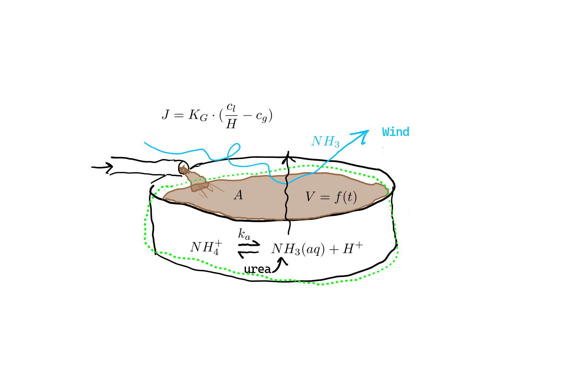

# Mini-project 1 solution

## Assignment description
See the [original description online](https://au-bce-ee.github.io/course-modelling-2026/classes/10-24-sept-mini-proj/exercises/mini_proj_slurry.html).

## 1. Conceptual model

There are at least three different conceptual models that could be used here, with differences in simplifications and assumptions.
Here we'll cover one, a more comprehensive one, in detail and try to explain where other approaches would differ.

In our conceptual model, we have a tank with slurry that contains a uniform concentration of total ammonia (or total ammoniacal nitrogen, TAN).
Free ammonia ($\ce{NH3(aq)}$), which is in pH-dependent chemical equilibrium with ammonium ($\ce{NH4+}$) is lost from the tank through volatilization.
This reduces the amount of total ammonia (or total ammoniacal nitrogen, TAN) in the tank.
Slurry is continually added to the tank at a constant rate, but not continually removed.
Instead, after some weeks or months of filling, the tank is completely emptied, and the slurry, with its remaining TAN, is added to crop fields.
The ammonia that was volatilized is not available for crop application, and the difference in concentration between fresh slurry (at the point where it is added to the tank) and stored slurry (once the tank is emptied) shows how much has been lost.

So both TAN mass and slurry volume are state variables.
Although urea is normally hydrolyzed quite quickly, we'll include it as a state variable as well, to have a more flexible model that could, for example, simulate the effect of urea hydrolysis inhibitors.

Here is a sketch of the conceptual model:

{#fig-concept1 fig-alt="Ammonia volatilization model concept"}

## 2. Balance/conservation equations

For the complete model, we need conservation equations for each state variable.

For slurry mass, we have:

rate of accumulation = rate of slurry addition

Here the rate of slurry addition is simply the rate at which slurry is pumped or somehow loaded into the tank.

Urea:

rate of accumulation = rate of addition in slurry - rate of urea hydrolysis

TAN:

rate of accumulation = rate of addition in slurry + rate of urea hydrolysis - rate of volatilization

Note that free ammonia does not show up here!
See [section 6.6 in the book](https://au-bce-ee.github.io/modeling-py-book/06_reactions_microbiology.html#sec-eq-v-kin) for more on this.


## 3. Constitutive equation

For TAN and urea addition via slurry flow, we have advection:

$$
\dot{m} = c \cdot \dot{V},
$$

where $\dot{m}=$ the mass flow rate of urea or TAN (e.g., $\gps$), $c=$ the concentration (e.g., $\gpmc$), and $V=$ volumetric slurry flow rate ($\mcps$).

For volatilization, the appropriate constitutive equation is this one:

$$
J = K_G \cdot (c_g^* - c_g).
$$

where $c_g = $ the ambient (background atmospheric) gaseous concentration of ammonia and $c_g^* =$ the free ammonia concentration in slurry, converted to gas phase units, i.e., $c_g^* = \frac{c_l}{H}$, where $H=$ dimensionless Henry's law constant (aq:g), i.e., the ratio of equilibrium concentration in the slurry divided by the concentration in the gas phase, and $c_l = $ the liquid (aqueous) phase concentration of free ammonia $\ce{NH3(aq)$.
Why free ammonia and not TAN?
Because free ammonia is the volatile component.
Charged solutes are not volatile.

Because urea is included, we also need an equation for hydrolysis. 
We'll assume a first-order reaction, so the volumetric rate of urea hydrolysis (e.g., $\gpmcps$) is:

$$
r_{urea} = k_u \cdot c_{urea}.
$$

We could convert to a mass-based rate by using the urea mass instead of concentration.

$$
\dot{m}_{urea} = k_u \cdot m_{urea}.
$$

What are the units?
Well, they aren't fixed.
Mole-based units are common, but here we could just use nitrogen (N) mass, e.g., g.
The advantage is that the rate of TAN production by urea hydrolysis is exactly $r_{urea}$ as well.
This means we don't need to explicitly use stoichiometric coefficients.

## 4. Linking equations

We could put the equation for the conversion of liquid (aqueous) phase free ammonia to the equivalent gas-phase concentration here:

$$
c_g^* = \frac{c_l}{H}.
$$

We also need a way to link $c_l$, which is the slurry concentration of free ammonia, to the TAN concentration or mass.
This is because $c_l$ is in our constitutive equation for volatilization rate, but TAN is our state variable.

## 5. Initial or boundary conditions

For this dynamic model we'll need to have some initial concentrations, of TAN and urea, as initial conditions.
Slurry volume is another initial condition.

## 6. Governing equation

Now we put things together.
We need a governing equation (GE) for each of our three state variables.

Slurry volume is simple:

$$
\frac{dV}{dt} = \dot{V}.
$$

That is, the time derivative of slurry volume is equal to the slurry flow rate into the tank.

For urea, remembering that we are using mass of nitrogen (N) (not moles N, not moles urea or moles or mass ammonia) as our fundamental unit for urea and TAN, and using the abbreviation $u$ for urea, we have:

$$
\frac{du}{dt} = c{u,in} \cdot \dot{V} - k_u \cdot m_u.
$$

Finally, for TAN, we have three terms on the RHS (see conservation equation above).

$$
\frac{dTAN}{dt} = c{TAN,in} \cdot \dot{V} + k_u \cdot m_u - K_G \cdot (\frac{c_l}{H} - c_g) \cdot A.
$$

When it comes to implementing the model, it can be clearer to define separate variables (objects) for those terms on the RHS, and then combine the objects.

For simpler models, just drop terms from the formulation and GE, e.g., no advection.

## 7. Implementation

The model described above is implemented as the `stmod()` function in the `slurry_tank` module.

```{.python filename="slurry_tank.py"}

```

Note that in this model, Henry's law is calculated from temperature, and that is done using a function.
The same goes for TAN speciation.
It is not necessary to use a separate function but can help to improve code readability and portability.

There are some simpler alternatives in this file:

```{.python filename="slurry_tank_alt.py"}

```

## 8. Application

```{python}
import numpy as np
import matplotlib.pyplot as plt
import slurry_tank as st
from importlib import reload
reload(st)
```

Let's sort out some inputs.
Say we have 200 cows, each producing around 80 kg of slurry per day.
We will only run the model with a filling tank, without any removal.

```{python} 
f_in = 200 * 80 / 1000 / 86400
f_out = 0.
```

For the tank area, let's assume a 4 m deep tank still needs to hold 200 days' worth of manure.

```{python}
depth = 4.
a_top = f_in * 200 * 86400 / depth
a_top
```

What does this imply for a tank diameter, assuming a cylindrical tank?

```{python}
2 * np.sqrt(a_top / np.pi) 
```

32 m is plausible.

Let's set the other inputs.

```{python}
kg = 0.01
c_bg = 0. 
pH = 7.
c_TAN_0 = 3
c_urea_0 = 0
ku = 0.
temp_c = 15.
```

Finally, let's run the model.
We have assumed the tank should be emptied after no more than 200 days, so we'll run it that long.

```{python}
reload(st)
pred_10 = st.stmod(f_in=f_in,
                   f_out=f_out,
                   a_top=a_top,
                   c_TAN_0=c_TAN_0,
                   c_urea_0=c_urea_0,
                   c_bg=c_bg,
                   pH=pH,
                   ku=ku,
                   kg=kg,
                   temp_c=temp_c,
                   t_range=[0, 200 * 86400], 
                   t_step=3600)
```

Plot results.
Note that these are now masses, not concentrations.

```{python}
plt.plot(pred_10['t'] / 86400, pred_10['m_TAN'])
plt.xlabel('Time (d)')
plt.ylabel('Tank TAN (kg)')
```

```{python}
plt.close()
plt.plot(pred_10['t'] / 86400, pred_10['v_man'])
plt.xlabel('Time (d)')
plt.ylabel('Tank manure (m3)')
```

```{python}
plt.plot(pred_10['t'] / 86400, pred_10['c_TAN'])
plt.xlabel('Time (d)')
plt.ylabel('Tank TAN conc. (kg/m3)')
```

Interestingly, a steady state concentration is very quickly reached.
How is this possible?
Well, we start with very little slurry in the tank, but the area of that slurry is always the same.
So it has a very high rate of volatilization relative to the TAN present.
It might be more interesting to start with more slurry.

```{python}
reload(st)
pred_11 = st.stmod(f_in=f_in,
                   f_out=f_out,
                   a_top=a_top,
                   c_TAN_0=c_TAN_0,
                   c_urea_0=c_urea_0,
                   c_bg=c_bg,
                   pH=pH,
                   ku=ku,
                   kg=kg,
                   temp_c=temp_c,
                   t_range=[0, 200 * 86400], 
                   t_step=3600,
                   m_TAN_0=c_TAN_0*100,
                   v_man_0=100)
```

Plot results.

```{python}
plt.close()
plt.plot(pred_11['t'] / 86400, pred_11['v_man'])
plt.xlabel('Time (d)')
plt.ylabel('Tank manure (m3)')
```

```{python}
plt.plot(pred_11['t'] / 86400, pred_11['c_TAN'])
plt.xlabel('Time (d)')
plt.ylabel('Tank TAN conc. (kg/m3)')
```

And for this reference scenario of sorts, we can calculate the N loss.
At the end!

```{python}
100 * (1 - pred_11['c_TAN'][-1] / c_TAN_0)
```

Compare to the earlier solution, which would reach steady-state sooner.

```{python}
100 * (1 - pred_10['c_TAN'][-1] / c_TAN_0)
```

We'll evaluate a different scenario with this model: reducing the area of the tank.
Let's cut it in half.

```{python}
pred_12 = st.stmod(f_in=f_in,
                   f_out=f_out,
                   a_top=a_top/2,
                   c_TAN_0=c_TAN_0,
                   c_urea_0=c_urea_0,
                   c_bg=c_bg,
                   pH=pH,
                   ku=ku,
                   kg=kg,
                   temp_c=temp_c,
                   t_range=[0, 200 * 86400], 
                   t_step=3600,
                   m_TAN_0=0,
                   v_man_0=1e-6)
```

Plot results.

```{python}
plt.close()
plt.plot(pred_12['t'] / 86400, pred_12['v_man'])
plt.xlabel('Time (d)')
plt.ylabel('Tank manure (m3)')
```

```{python}
plt.plot(pred_12['t'] / 86400, pred_12['c_TAN'])
plt.xlabel('Time (d)')
plt.ylabel('Tank TAN conc. (kg/m3)')
```

Calculate the N loss.

```{python}
100 * (1 - pred_12['c_TAN'][-1] / c_TAN_0)
```


