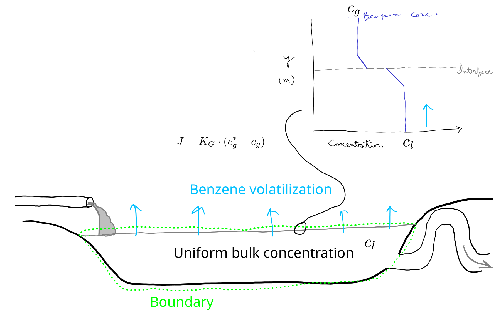

# Time-variable model exercise

Here you will use the bezene volatilization model from the mass transfer exercise.
In the conceptual model, we have uniform benzene concentrations in the bulk air and wastewater.
Contaminated wastewater is continuously added and older wastewater flows out through an outlet.
Because of mixing due to wastewater flow and wind- and temperature-driven transport, we can assume a uniform benzene concentration in the bulk of the lagoon, like a completely stirred tank reactor (CSTR).
We could (and did) represent this situation with a steady-state model if the mass transfer coefficient is constant, but here you will create a time-variable model where that mass transfer coefficient changes over time.

Here is a sketch of the conceptual model:

{#fig-benz-concept fig-alt="Benzene volatilization model concept"}

For more details, you can check the [solution](https://au-bce-ee.github.io/course-modelling-2026/classes/06-10-sept-mass-transfer/solutions/benz_sol.html) to the original mass transfer exercise.

The Python module `benz_mod.py` has a numerical implementation of a model with constant and equal inflow and outflow.
It has been changed slightly from the earlier solution--here there are separate inputs for initial lagoon benzene concentration and wastewater concentration.

```{.python filename="benz_mod.py"}

```

Here is a demo, starting with a benzene concentration of 10 $\gpmc$.

```{python}
import numpy as np
import matplotlib.pyplot as plt
from scipy.integrate import solve_ivp

import benz_mod as bnm
```

We'll use a much lower mass transfer coefficient here than in the earlier exercise, only because this value is more realistic.
And to make this lagoon at all effective, that means we need a much higher retention time.
We might also consider whether benzene should be allowed to simply volatilize into the atmosphere, but for now let's just accept that this system may not be a very realistic one!

```{python}
pred03 = bnm.benzvol_flow(
    clin=10, 
    cl0=10, 
    ca=0, 
    kg=2e-6, 
    depth=1,
    h=5,
    hrt=21 * 86400,
    t_range = (0, 3 * 30 * 86400),
    t_step = 3600
)
```

```{python}
plt.plot(pred03["t"] / 86400, pred03["cl"])
plt.xlabel("Time (days)")
plt.ylabel("Benzene conc. (g/m3)")
plt.show()
```

Add wind speed as a time-variable input and use to calculate a mass transfer coefficient internally.
Although we should expect that mass transfer resistance is water-side limited, and therefore wind might not have an effect, in fact wind at the surface still mixes the water column.
You can use this somewhat plausible correlation (most likely it gives high values):

$$
K_G = 1 \cdot 10^{-6} \frac {(1 + 0.1 \cdot w^2)} {1 + 0.1^2}
$$

where $w$ = wind speed ($\mps$).
Use the wind speed from the file [weather.csv](https://github.com/AU-BCE-EE/course-modelling-2026/blob/main/classes/22-12-nov-time-var/exercises/weather.csv) to generate some predictions.
(Select the download button near the top right to download it.)

Once you have that working, can you also add time-variable flow?
Assuming a constant volume, that would go in through the `hrt` variable.
Generate some flow data that have a 24 hour cycle, with no flow at the minimum (during night, perhaps) and use them to make model predictions.

