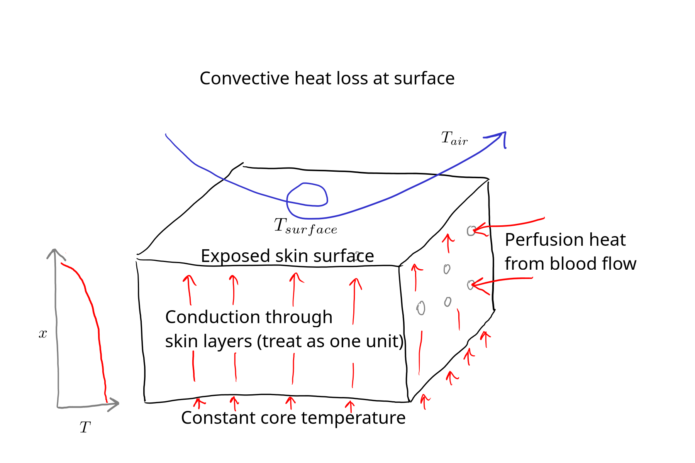

# Proposed exam problem: Bioheat model

Our skin can be painfully damaged by frostbite if it becomes too cold during exposure to cold air.
It is kept warm and healthy by conductive heat transfer from deeper tissue (the body "core") and from warm blood flowing into your tissue (perfusion).
Skin and underlying tissue temperature profiles can be modelled using a constant core temperature with perfusion treated as a volumetric source term (see sketch below).
This approach was first proposed decades ago (Pennes, 1948).
Here you will develop a dynamic model to predict skin temperature profiles under different conditions, and use it to answer some questions about frostbite and related issues.

{#fig-concept1 fig-alt="Skin heat transfer sketch"}

## 1. Model development and description
The first task is to develop a 1D model for predicting the temperature profile from the core to the skin. 
Your model should also calculate total heat loss at the surface.
Follow the steps we have used so far in the mini projects, with a description of the conceptual model, a sketch, assumptions that you made, including information on the coordinate system, simplification of the governing equations, boundary conditions, and initial conditions. 
List the state variable(s) and include the governing equations.
Your model must be able to handle air temperature that varies over time.

For your Python code, you should use a module-based approach (define a model function in a `*.py` module and then write the code for verification, validation, and application in separate `*.py` scripts).
Be sure to comment your code enough that someone could understand it without input from you!
That information should be present in docstrings and single line comments.
You can find examples of this throughout the book, an explanation in [Chapter3](https://au-bce-ee.github.io/modeling-py-book/03_solving.html), and an example you could download in the [parameter estimation solution](https://github.com/AU-BCE-EE/course-modelling-2026/blob/main/classes/21-01-nov-par-est/script-solution).

## 2. Verification 
Implement checks to ensure that your heat balance adds up and that no energy is unaccounted for. 
Use other verification test to ensure that you model responds correctly to input parameters. 
Verification code can go in the appendix, but main conclusions should be written in the report.   

## 3. Parameter estimation
Blood perfusion rate can vary considerably, depending on the level of physical exertion and the outdoor temperature.
The measurements in the file `skin_temperature.csv` can be used to determine a best-fit value through parameter estimation.
The data are for the surface temperature of skin on a subject's cheek measured after 1 hour at room temperature and 1 hour at a much cooler temperature.
Air temperature for the experiment is given in the file `air_temp.csv`.
Use the data to estimate the perfusion rate for your model. 

Note that it would not be realistic to assume a uniform temperature profile in the 10 mm of skin at the start of the experiment.
Instead, you should run a "startup" simulation using the initial air temperature in `air_temp.csv` or a similar value, and use output for the next simulation, with variable air temperature.

## 4. Model application and research questions
* Simulate the skin temperature profile of a human that is exposed to outdoor air over 1 hour. You can run a "startup" simulation to generate a profile for use in the following simulations.
* How cold would it need to be for the skin surface to reach a temperature of 0 $\degC$ and thereby risk frostbite? If you struggle to ever reach frostbite conditions, you might try two changes: adjust the parameter that controls surface heat loss and responds to wind speed (you should know what we mean), and recognize that vasoconstriction (blood vessels shrinking) is a natural response to cold skin to reduce heat loss and it can greatly reduce perfusion.
* Simulate the effect of a warm jacket under those cold conditions that caused frostbite.
* Perfusion may decrease by as much as a factor of 10 when skin cools, in order to conserve body heat. How much does this change reduce heat loss under the cold conditions?

## 5. Parameter values

You should assume the following for parameter estimation and reference conditions for model application.

* Skin and tissue thickness, below which a constant core temperature is maintained: 10 mm
* Core temperature maintained at 10 mm and lower: 37 $\degC$
* Surface heat transfer convection coefficient (indoors): 9 $\WpmspK$
* Skin and tissue thermal conductivity: 0.3 $\WpmpK$
* Density: 1000 $\kgpmc$
* Specific heat capacity: 3600 $\Jpkg$

## Reference
Pennes, H. 1948. Analysis of tissue and arterial blood temperatures in the resting human forearm.
*Journal of Applied Physiology* 1(2): 93.

## Report 
