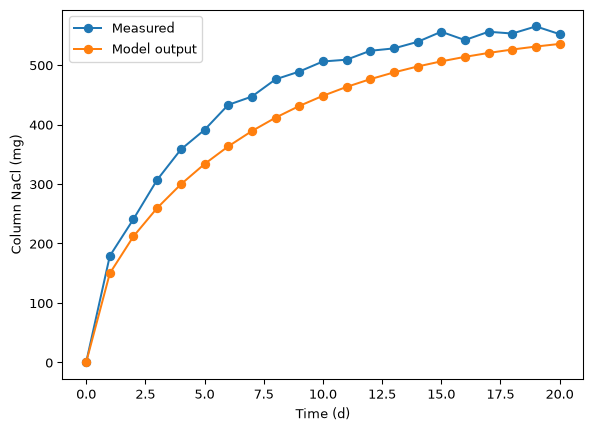

# 1D diffusion model solution
Sasha D. Hafner

Let’s start by looking at the measurement data. We’ll use pandas.

``` python
import pandas as pd
```

``` python
measdat = pd.read_csv('col_salt.csv')
measdat
```

<div>
<style scoped>
    .dataframe tbody tr th:only-of-type {
        vertical-align: middle;
    }
&#10;    .dataframe tbody tr th {
        vertical-align: top;
    }
&#10;    .dataframe thead th {
        text-align: right;
    }
</style>

|     | time_d | salt_mg |
|-----|--------|---------|
| 0   | 0      | 0       |
| 1   | 1      | 179     |
| 2   | 2      | 241     |
| 3   | 3      | 307     |
| 4   | 4      | 358     |
| 5   | 5      | 391     |
| 6   | 6      | 433     |
| 7   | 7      | 447     |
| 8   | 8      | 476     |
| 9   | 9      | 489     |
| 10  | 10     | 506     |
| 11  | 11     | 509     |
| 12  | 12     | 524     |
| 13  | 13     | 528     |
| 14  | 14     | 539     |
| 15  | 15     | 556     |
| 16  | 16     | 542     |
| 17  | 17     | 556     |
| 18  | 18     | 553     |
| 19  | 19     | 565     |
| 20  | 20     | 552     |

</div>

Seems we have even 1 d spacing in time, which is convenient. We can
match that exactly without changing the `diff1D()` function and align
model output and measurements without a merge operation.

Load our model function.

``` python
import diff_mod as dm
```

And other modules.

``` python
import numpy as np
import matplotlib.pyplot as plt
```

So here is our model call.

``` python
pred01 = dm.diff1D(
    L = 0.1,
    n = 50,
    D = 1.6E-9,
    bc = [36, 0],
    ci = 0,
    t_eval = np.linspace(0, 20 * 86400, 21)
)
```

And we can use the same approach that was shown in the exercise for
calculating accumulation. We will need the cross-sectional area.

``` python
area = np.pi * (0.02 / 2)**2 
area
```

    0.0003141592653589793

The `numpy.sum()` function accepts an axis parameter (second parameter).
The help file doesn’t really illuminate how to set it, but with
experimentation you can figure out how to add up all the columns, so you
have one sum per time.

``` python
salt_mod = (pred01['c'] * pred01['dx'] * area).sum(0)
salt_mod
```

    array([0.        , 0.00014977, 0.000212  , 0.00025964, 0.00029939,
           0.00033354, 0.00036318, 0.00038899, 0.0004115 , 0.00043113,
           0.00044826, 0.00046321, 0.00047625, 0.00048763, 0.00049756,
           0.00050622, 0.00051377, 0.00052037, 0.00052612, 0.00053114,
           0.00053552])

We should check to make sure that this output array has the same length
as the number of times. It does: 21.

Units here are kg, and the measurement data are in mg. And time there is
in h.

If we are sure that we used the right times in the model call, we could
just add a column with model output. We’ll start with that. First, make
a new data frame that will hold measurements and model output.

``` python
mmdat = measdat.copy()
```

And add the model output we processed above.

``` python
mmdat['salt_mod_mg'] = salt_mod * 1E6
mmdat
```

<div>
<style scoped>
    .dataframe tbody tr th:only-of-type {
        vertical-align: middle;
    }
&#10;    .dataframe tbody tr th {
        vertical-align: top;
    }
&#10;    .dataframe thead th {
        text-align: right;
    }
</style>

|     | time_d | salt_mg | salt_mod_mg |
|-----|--------|---------|-------------|
| 0   | 0      | 0       | 0.000000    |
| 1   | 1      | 179     | 149.773978  |
| 2   | 2      | 241     | 212.002236  |
| 3   | 3      | 307     | 259.642982  |
| 4   | 4      | 358     | 299.389395  |
| 5   | 5      | 391     | 333.537495  |
| 6   | 6      | 433     | 363.175828  |
| 7   | 7      | 447     | 388.989435  |
| 8   | 8      | 476     | 411.498665  |
| 9   | 9      | 489     | 431.133657  |
| 10  | 10     | 506     | 448.264052  |
| 11  | 11     | 509     | 463.210089  |
| 12  | 12     | 524     | 476.250485  |
| 13  | 13     | 528     | 487.628038  |
| 14  | 14     | 539     | 497.555009  |
| 15  | 15     | 556     | 506.216288  |
| 16  | 16     | 542     | 513.773309  |
| 17  | 17     | 556     | 520.366726  |
| 18  | 18     | 553     | 526.119486  |
| 19  | 19     | 565     | 531.138819  |
| 20  | 20     | 552     | 535.518175  |

</div>

We can already seen the order or magnitude is OK.

But it is safer to do a proper merge. This would work even if we had
some times in the model output that were not present in the measurement
DataFrame, or vice versa. For that we need to combine model time and our
response variable. And it is easiest to merge in a DataFrame, so we’ll
do that.

``` python
moddat = pd.DataFrame({
    'time_d': pred01['t'] / 86400,
    'salt_mod_mg': salt_mod * 1E6
})

moddat
```

<div>
<style scoped>
    .dataframe tbody tr th:only-of-type {
        vertical-align: middle;
    }
&#10;    .dataframe tbody tr th {
        vertical-align: top;
    }
&#10;    .dataframe thead th {
        text-align: right;
    }
</style>

|     | time_d | salt_mod_mg |
|-----|--------|-------------|
| 0   | 0.0    | 0.000000    |
| 1   | 1.0    | 149.773978  |
| 2   | 2.0    | 212.002236  |
| 3   | 3.0    | 259.642982  |
| 4   | 4.0    | 299.389395  |
| 5   | 5.0    | 333.537495  |
| 6   | 6.0    | 363.175828  |
| 7   | 7.0    | 388.989435  |
| 8   | 8.0    | 411.498665  |
| 9   | 9.0    | 431.133657  |
| 10  | 10.0   | 448.264052  |
| 11  | 11.0   | 463.210089  |
| 12  | 12.0   | 476.250485  |
| 13  | 13.0   | 487.628038  |
| 14  | 14.0   | 497.555009  |
| 15  | 15.0   | 506.216288  |
| 16  | 16.0   | 513.773309  |
| 17  | 17.0   | 520.366726  |
| 18  | 18.0   | 526.119486  |
| 19  | 19.0   | 531.138819  |
| 20  | 20.0   | 535.518175  |

</div>

Now merge.

``` python
mmdat2 = pd.merge(measdat, moddat, on = 'time_d')

mmdat2
```

<div>
<style scoped>
    .dataframe tbody tr th:only-of-type {
        vertical-align: middle;
    }
&#10;    .dataframe tbody tr th {
        vertical-align: top;
    }
&#10;    .dataframe thead th {
        text-align: right;
    }
</style>

|     | time_d | salt_mg | salt_mod_mg |
|-----|--------|---------|-------------|
| 0   | 0      | 0       | 0.000000    |
| 1   | 1      | 179     | 149.773978  |
| 2   | 2      | 241     | 212.002236  |
| 3   | 3      | 307     | 259.642982  |
| 4   | 4      | 358     | 299.389395  |
| 5   | 5      | 391     | 333.537495  |
| 6   | 6      | 433     | 363.175828  |
| 7   | 7      | 447     | 388.989435  |
| 8   | 8      | 476     | 411.498665  |
| 9   | 9      | 489     | 431.133657  |
| 10  | 10     | 506     | 448.264052  |
| 11  | 11     | 509     | 463.210089  |
| 12  | 12     | 524     | 476.250485  |
| 13  | 13     | 528     | 487.628038  |
| 14  | 14     | 539     | 497.555009  |
| 15  | 15     | 556     | 506.216288  |
| 16  | 16     | 542     | 513.773309  |
| 17  | 17     | 556     | 520.366726  |
| 18  | 18     | 553     | 526.119486  |
| 19  | 19     | 565     | 531.138819  |
| 20  | 20     | 552     | 535.518175  |

</div>

Finally, let’s plot the results for comparison.

``` python
plt.plot(mmdat2.time_d, mmdat2.salt_mg, marker = 'o', label = 'Measured')
plt.plot(mmdat2.time_d, mmdat2.salt_mod_mg, marker = 'o', label = 'Model output')
plt.xlabel('Time (d)')
plt.ylabel('Column NaCl (mg)')
plt.legend()
```



Well, clearly the model underestimates NaCl accumulation, even if we
consider that there is some random error in measurements (see it?). But
measurements and the model both show the same shape and are not terribly
far off.

We can get quantitative using the model fit statistics we discussed in
class on Thursday. Let’s load the module.

``` python
import mod_fit as mf
```

First mean bias.

``` python
mf.mbe(mmdat.salt_mg, mmdat.salt_mod_mg)
```

    np.float64(-42.657897805438154)

So that’s a mean bias of under 10% of the maximum. That would not be
terrible for an environmental model, but depending on the application,
better accuracy might be needed.

Mean absolute error is similar.

``` python
mf.mae(mmdat.salt_mg, mmdat.salt_mod_mg)
```

    np.float64(42.657897805438154)

Not surprising, from looking at the plot, which shows that most of the
error is related to bias.
